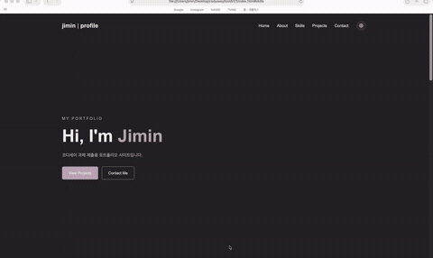
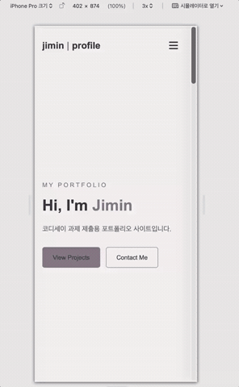
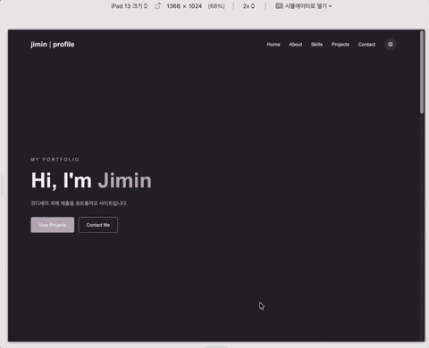
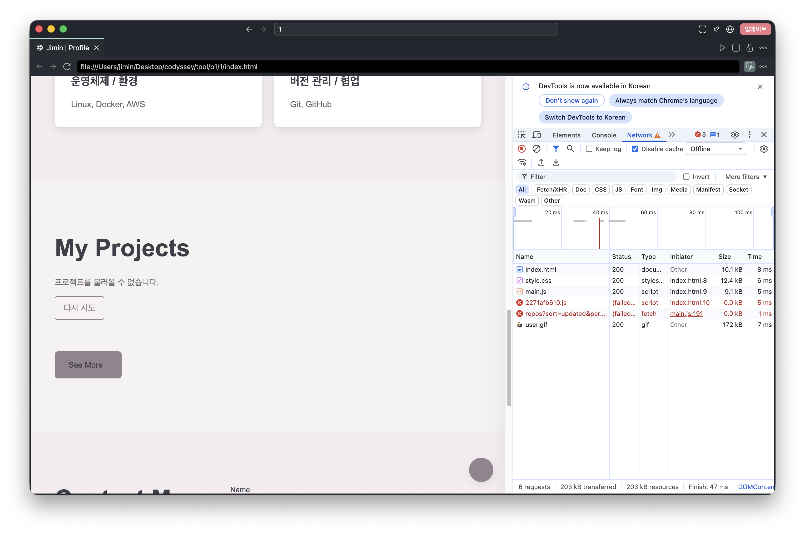
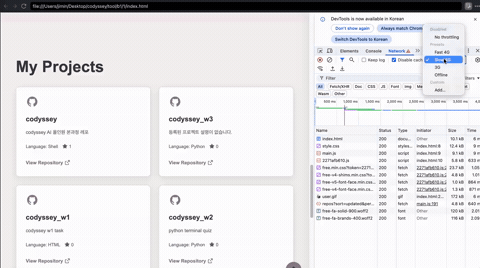

# Jimin | Profile Portfolio

개인 소개와 학습 과정, GitHub 프로젝트를 보여 주는 반응형 포트폴리오 웹사이트입니다.
순수 HTML, CSS, JavaScript를 사용해 구현했습니다.

## Demo

- GitHub Repository: https://github.com/{깃허브_아이디}/{레포_이름}
- GitHub Pages: [배포 링크](https://ji-min0.github.io/codyssey/)

## 구현 기능

- Hero, About, Skills, Projects, Contact 섹션
- 모바일·태블릿·데스크톱 반응형 레이아웃
- 모바일 햄버거 메뉴
- 다크 모드 및 테마 설정 유지
- 부드러운 스크롤
- 스크롤 위치에 따른 내비게이션 스타일 변경
- 페이지 맨 위로 이동하는 버튼
- Intersection Observer를 이용한 스크롤 애니메이션
- GitHub API 기반 프로젝트 목록 렌더링
- 문의 폼 필수값 및 이메일 형식 검증 (실제 전송은 x)

## Tech Stack

- HTML5
- CSS3
- Vanilla JavaScript
- GitHub REST API
- GitHub Pages

외부 UI 프레임워크와 JavaScript 라이브러리 없이 구현했습니다. 아이콘은 Font Awesome을 사용합니다.

## Project Structure

```text
.
├── index.html
├── css/
│   └── style.css
├── js/
│   └── main.js
├── images/
└── screenshots/
    ├── offline.png
    ├── slow.gif
    ├── desktop.gif
    ├── mobile.gif
    └── tablet.gif
```

## GitHub API

다음 엔드포인트에서 공개 저장소 목록을 가져옵니다.

https://api.github.com/users/{깃허브_아이디}/repos?sort=updated&per_page=100

저장소 이름, 설명, 언어, Star 수, 저장소 주소를 카드에 표시합니다. API 요청 중에는 로딩 상태를 표시하고, 요청 실패 시 재시도 버튼을 제공합니다. 저장소 목록이 비어 있는 경우 빈 상태 메시지를 표시합니다.

인증되지 않은 GitHub API 요청에는 요청 횟수 제한이 적용될 수 있습니다.

## Contact Form

이름, 이메일, 메시지의 필수값과 이메일 형식을 검사합니다. 입력 오류는 각 필드 아래에 표시합니다.

현재 문의 폼은 프론트엔드 유효성 검사 시연용이며 실제 이메일은 전송하지 않습니다.

## Interaction Thresholds

- Navigation style: 스크롤 60px 이상
- Scroll-to-top button: 스크롤 300px 이상
- Intersection Observer threshold: 0.2

## Deployment

1. GitHub 저장소에 과제용 파일을 올립니다.
2. 저장소의 Settings → Pages로 이동합니다.
3. Deploy from a branch를 선택합니다.
4. 배포할 브랜치와 `/ (root)` 폴더를 선택합니다.
5. 배포가 완료되면 표시된 URL을 위 Demo 항목에 기록합니다.

## Screenshots

### Desktop (+ dark mode)



### Mobile (+ dark mode)



### Tablet Mode (+ dark mode)



### Offline


### Slow network
